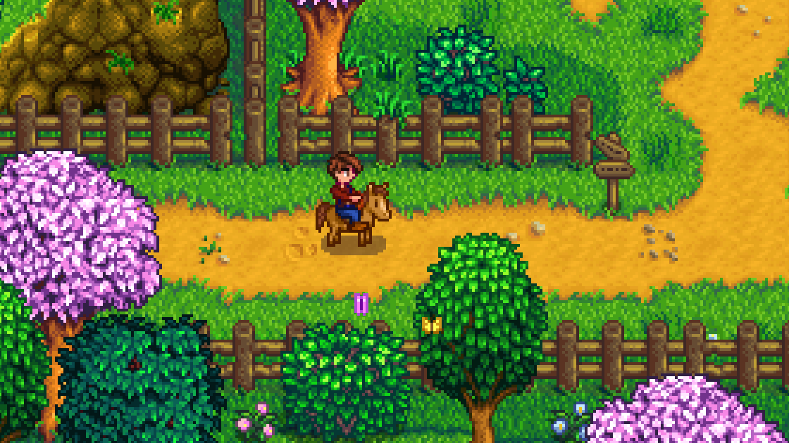

# Secretariat (Faster Horse)

Secretariat adds **+3 speed** to your horse while you ride. The bonus stacks with coffee, carrots, and the Horse book. Dismount and your farmer returns to their usual speed, including any active buffs or debuffs.

## Install

1. Install [SMAPI](https://smapi.io/) for Stardew Valley 1.6.
2. Download Secretariat from [Nexus Mods](https://www.nexusmods.com/stardewvalley/mods/7537) and extract the `Secretariat` folder into `Stardew Valley/Mods`. When updating, keep your existing `config.json`.
3. Launch Stardew Valley through SMAPI and saddle up.

## Change the boost

Launch the game through SMAPI once, then quit. Open `Mods/Secretariat/config.json` in a text editor and change `SpeedBoost` to a whole number. Save the file and relaunch through SMAPI.

```json
{
  "SpeedBoost": 3
}
```

The value is extra speed in game units. Try `1` for a gentler boost, `5` for a faster ride, or `0` for vanilla horse speed.

## Multiplayer and other mods

Each rider who wants the bonus should install Secretariat on their computer. Split-screen players share the computer's setting. Each farmer gains and loses the bonus independently.

Secretariat uses a hidden Stardew Valley speed buff with its own ID. It leaves other mods' buffs, the game's movement code, and the horse sprite intact.

Tested on Forge with the Steam version of Stardew Valley 1.6.15 (build 24356) and SMAPI 4.5.2. The host and farmhand rode and dismounted independently in split-screen. Separate launches also verified `SpeedBoost` values of 0 and 5.

## Gallery



The [Nexus cover illustration](media/secretariat-cover.jpg) was generated with OpenAI ImageGen. The screenshot above was captured in-game.

<details>
<summary>Cover illustration prompt</summary>

Use case: stylized-concept. Create a landscape 16:9 Nexus Mods cover illustration for Secretariat, the Stardew Valley horse-speed mod. A single sturdy, friendly golden chestnut farm horse with a dark auburn mane and tail and the simple brown saddle with an ochre saddle blanket seen on the vanilla Stardew horse, galloping along a sunlit farm lane. Show its full body in a clear three-quarter side view, traveling to the right, with natural galloping anatomy and a few flecks of dust. Give the scene the warmth of a hand-painted rural travel poster: textured gouache, distinct silhouettes, apple-green pasture, a weathered split-rail fence, distant blue valley hills. Keep the horse large and near the center so it reads at thumbnail size and in a shallow banner crop. No rider, lettering, logos, borders, or HUD.

</details>
